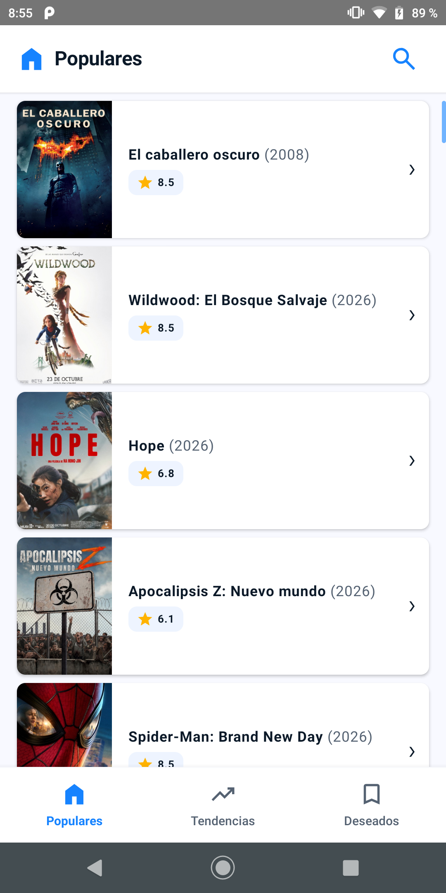
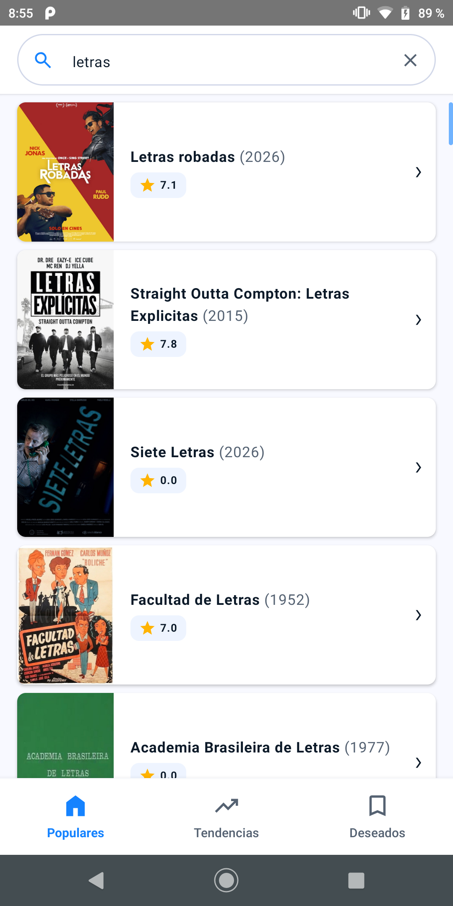
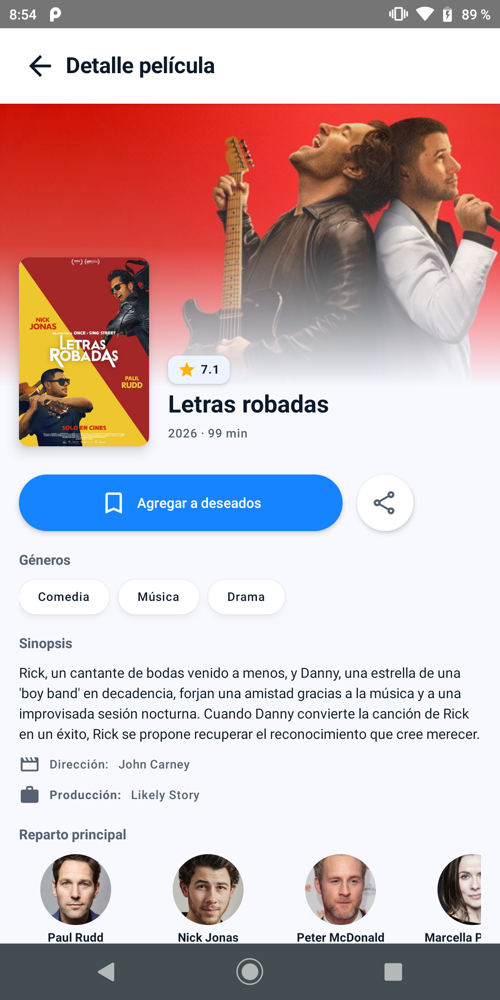

# FilmZoom

Aplicación móvil nativa para Android de exploración y seguimiento de películas utilizando la API REST de **The Movie Database (TMDB)**. Desarrollada como Trabajo Práctico Integrador para el Seminario de Android de la Tecnicatura Universitaria en Desarrollo de Aplicaciones Informáticas (TUDAI - UNICEN).

  
  
  

---

## Ejecución rápida

1. Clonar el repositorio.
2. Abrir el proyecto en Android Studio.
3. Configurar tu Read Access Token o API Key de TMDB en el archivo `local.properties` *(ejemplo: `TMDB_API_KEY=tu_token`).*
4. Sincronizar el proyecto con Gradle, compilar y ejecutar en un emulador o dispositivo físico compatible *(compatible desde `minSdk 26`).*

---

## Tecnologías y Librerías

- **Lenguaje:** Kotlin
- **Interfaz de Usuario:** Jetpack Compose (Material 3)
- **Arquitectura:** MVVM (Model-View-ViewModel) con Unidirectional Data Flow (UDF)
- **Inyección de dependencias:** Hilt
- **Red:** Retrofit2, OkHttp
- **Paginado y Persistencia:** Paging 3, Room Database
- **Carga de imágenes:** Coil

---

## Funcionalidades Principales

- Listado de películas populares con carga infinita mediante Paging 3.
- Búsqueda en tiempo real que oculta el catálogo popular y muestra los resultados encontrados, incluyendo mensaje de estado cuando no hay resultados.
- Navegación por pestañas: Populares, Tendencias de la semana y Lista de deseados.
- Persistencia local de la lista de deseados mediante Room Database, con su respectiva retroalimentación visual al agregar o quitar elementos.
- Vista de detalle de película con sinopsis, calificación, géneros y lista de películas recomendadas que permiten navegar hacia su propio detalle.
- Adaptación automática del idioma de las consultas según la configuración regional del dispositivo (Locale).
- Uso de *Intents* para compartir información de la película con otras aplicaciones y abrir el sitio web oficial en el navegador predeterminado.
- Soporte para modo claro y modo oscuro según las preferencias del sistema.
- Manejo de estados de carga, indicadores visuales de progreso y opciones de reintentar ante fallos de red o de I/O.

---

## Decisiones de Arquitectura

El proyecto se estructuró siguiendo el **patrón MVVM** y el **patrón Repositorio** para separar la lógica de negocio de la capa de presentación y de las fuentes de datos, garantizando un diseño desacoplado y con alta testeabilidad mediante Hilt.

- **Capa de Presentación:** Construida 100% con Jetpack Compose. La UI reacciona a los cambios de estado expuestos desde los ViewModels mediante StateFlow.
- **Capa de Datos:** El repositorio centraliza las peticiones a la API remota (Retrofit) y la gestión de la base de datos local (Room).
